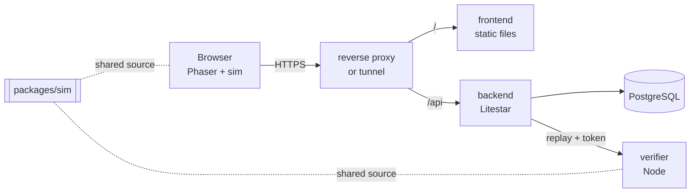

# Architecture

## Components

| Component  | Directory      | Responsibility                                                                                       |
| ---------- | -------------- | ---------------------------------------------------------------------------------------------------- |
| Simulation | `packages/sim` | Game rules, levels, replay format. Pure and deterministic. No DOM, no Phaser.                        |
| Frontend   | `frontend/`    | Renders the simulation with Phaser, collects keyboard and touch input, records the replay.           |
| Verifier   | `verifier/`    | Replays an untrusted input list against a server-owned level and reports the outcome. Internal only. |
| Backend    | `backend/`     | Accounts, JWT auth, run submission, personal bests, leaderboard, progress.                           |
| Database   | PostgreSQL     | `users` and `best_runs`.                                                                             |

The simulation is the single source of truth for what a run means. The client uses it to
play, the verifier uses the very same code to judge. That is what makes server-side
verification cheap and drift-free (see [ADR 0002](adr/0002-node-verifier-reusing-the-simulation.md)).

## Data flow of a run

1. The player plays in the browser. Every simulation tick (60 per second) the input mask
   (left, right, jump as bits) is appended to a list.
2. When the exit is reached, the list is run-length encoded to `[mask, count, ...]`.
3. The client sends `POST /api/runs` with `{level_id, replay, sim_version, level_revision}`
   and its bearer token. The two versions are the ones the replay was recorded with.
4. The backend validates size and shape, then asks the verifier to replay it.
5. The verifier refuses (409) a simulation version or level revision other than the ones it
   runs, decodes the replay (strictly), looks the level up **by id on the server**,
   simulates it and answers with `{finished, frames, deaths, score, flags}`; see
   [SCORING.md](SCORING.md) and [VERSIONING.md](VERSIONING.md).
6. The backend stores the result only if it finished the level and is the user's best one by
   score, together with the versions it was verified against. The numbers on the
   leaderboard are the ones the verifier computed.

## Simulation model

- Fixed tick, 60 per second. A tick is the unit of time and of replay entries.
- Tile based collision (32 px tiles), 24x28 player box, per-axis movement and resolution.
- A level has one to four stages. Reaching a stage's exit loads the next stage, the last exit
  finishes the run.
- A run spans all lives. Dying resets position and the traps of the current stage; the tick
  counter and the death counter keep running.
- Traps are one-shot per life: when the player overlaps the trigger rectangle, a set of
  tiles is removed, made solid, or turned into spikes.

## Data model

| Table          | Columns                                                                                                                                              | Notes                                                                                                                   |
| -------------- | ---------------------------------------------------------------------------------------------------------------------------------------------------- | ----------------------------------------------------------------------------------------------------------------------- |
| `users`        | `id`, `username`, `username_key` (unique, lower case), `password_hash` (argon2), `token_version`, `is_admin`, `flagged`, `created_at`                | `token_version` is embedded in JWTs and allows revoking all tokens of a user.                                           |
| `best_runs`    | `id`, `user_id`, `level_id`, `score`, `frames`, `deaths`, `replay` (JSON), `sim_version`, `level_revision`, `flags` (JSON), `hidden`, `submitted_at` | Unique per `(user_id, level_id)`. A row doubles as the completion record, so progress is derived, not stored twice.     |
| `audit_events` | `id`, `created_at`, `kind`, `user_id` (nullable), `actor_id` (nullable), `level_id`, `reason`, `replay_size`, `request_id`                           | One row per refused submission or moderation action. No replay and no credentials; purged after `AUDIT_RETENTION_DAYS`. |

The schema is owned by Alembic migrations (`backend/alembic`). The backend container runs
`python -m trust_issues_backend.migrate` before the server starts: it waits for the database,
adopts a database that was created from the models before migrations existed (marks it as the
baseline) and refuses one that does not match, then upgrades to the newest revision. The
application itself never changes the schema; only the tests build it from the models, and a
test fails when the models and the migrations drift apart.

## HTTP API

| Method | Path                                    | Auth  | Purpose                                              |
| ------ | --------------------------------------- | ----- | ---------------------------------------------------- |
| GET    | `/health`                               | no    | Liveness plus database round trip                    |
| POST   | `/api/auth/register`                    | no    | Create an account                                    |
| POST   | `/api/auth/login`                       | no    | Exchange credentials for a bearer token              |
| GET    | `/api/auth/me`                          | yes   | Current user                                         |
| POST   | `/api/auth/logout-all`                  | yes   | Revoke every token of the caller                     |
| POST   | `/api/auth/password`                    | yes   | Change the password, returns a new token             |
| POST   | `/api/auth/delete`                      | yes   | Delete the account and its runs                      |
| POST   | `/api/runs`                             | yes   | Submit a replay                                      |
| GET    | `/api/progress`                         | yes   | Own completed levels with best runs                  |
| GET    | `/api/leaderboard/{level_id}`           | no    | Best scores with run ids, `?limit=1..100`            |
| GET    | `/api/leaderboard/{level_id}/page`      | no    | One page with `next_cursor`, `?limit=1..100&cursor=` |
| GET    | `/api/leaderboard/{level_id}/around-me` | yes   | The caller's rank with `?radius=1..25` neighbours    |
| GET    | `/api/ranking`                          | no    | Overall ranking by total frames, `?limit=1..100`     |
| GET    | `/api/replays/{run_id}`                 | no    | Stored replay of a visible leaderboard run           |
| \*     | `/api/admin/...`                        | admin | Moderation, see [MODERATION.md](MODERATION.md)       |

The OpenAPI schema is served at `/schema` only when `ENABLE_DOCS=true`.

## Build size

The production build has two script chunks. `index-*.js` holds the menus, the account and
leaderboard screens and the API client; `runtime-*.js` holds Phaser and the game scene and is
fetched in the background shortly after the first screen appears, or when a level is started
before that. If it cannot be fetched the player gets a retry screen. `npm run build` fails when
a chunk is over its gzip budget (40 KB for the entry, 400 KB for the game, see
`frontend/build/budget.ts`), so CI catches Phaser sneaking back into the entry chunk. The
hashed file names allow the long cache lifetime listed in [DEPLOYMENT.md](DEPLOYMENT.md).

## Paging

`/page` returns `next_cursor`, the position of the last entry. The next page continues
strictly after it, so nobody is repeated and everybody who stays below the cursor appears
exactly once, whatever is submitted meanwhile. A player whose new best run jumps above the
cursor while the pages are being read is not returned again; fetching the first page shows
them. Ranks are computed for every page, so they always match the current order.

## Progress

Progress is the best verified run per level. A guest's progress and replays live in the
browser. After signing in or registering, the game loads `GET /api/progress`, sends the guest
runs that beat what the server has (the server verifies them like any other run) and moves
all guest progress into a store kept per account (`trust-issues.progress.v1.<username>`), so a
second device or a fresh browser starts from the server's state. If the server cannot be
reached, nothing is changed and the sync runs again at the next start.

## Client session

The game keeps the access token in `localStorage` (or in memory when the browser refuses
storage) so a reload does not sign the player out. It reads only the expiry of the token and
signs out by itself when it has passed; the server decides what a token is worth. Any script
running on the page could read the token, which is the usual trade-off of this approach; the
site serves no third-party scripts and its content security policy limits scripts and
connections to its own origin. Signing out removes the local copy; `logout-all`, which revokes every token
through `token_version`, is tracked in the accounts epic.

## Network layout

The frontend container serves the static build and nothing else; it carries no proxy
configuration. The frontend and the backend publish a port on `127.0.0.1` each, and
whatever sits in front of the stack (a reverse proxy or a tunnel on the same host) routes
`/api/*` to the backend and everything else to the frontend. The verifier and the database
are reachable on the compose network only; the verifier additionally requires the shared
`VERIFIER_TOKEN`. The database port is bound to `127.0.0.1` for local development.

The backend limits request bodies to 256 KiB itself, so it does not depend on the proxy
for that.
