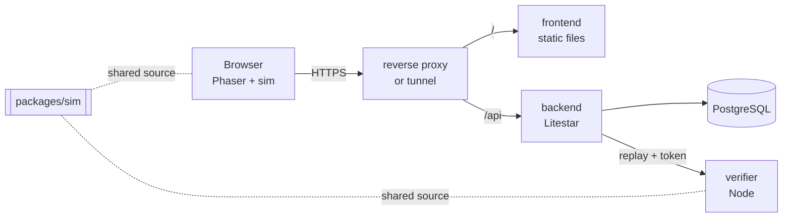

# Architecture

## Components

| Component  | Directory      | Responsibility                                                                                       |
| ---------- | -------------- | ---------------------------------------------------------------------------------------------------- |
| Simulation | `packages/sim` | Game rules, levels, replay format. Pure and deterministic. No DOM, no Phaser.                        |
| Frontend   | `frontend/`    | Renders the simulation with Phaser, collects keyboard and touch input, records the replay.           |
| Verifier   | `verifier/`    | Replays an untrusted input list against a server-owned level and reports the outcome. Internal only. |
| Backend    | `backend/`     | Accounts, JWT auth, run submission, personal bests, leaderboard, progress.                           |
| Database   | PostgreSQL     | `users` and `best_runs`.                                                                             |

The simulation is the single source of truth for what a run means. The client uses it to
play, the verifier uses the very same code to judge. That is what makes server-side
verification cheap and drift-free (see [ADR 0002](adr/0002-node-verifier-reusing-the-simulation.md)).

## Data flow of a run

1. The player plays in the browser. Every simulation tick (60 per second) the input mask
   (left, right, jump as bits) is appended to a list.
2. When the exit is reached, the list is run-length encoded to `[mask, count, ...]`.
3. The client sends `POST /api/runs` with `{level_id, replay}` and its bearer token.
4. The backend validates size and shape, then asks the verifier to replay it.
5. The verifier decodes the replay (strictly), looks the level up **by id on the server**,
   simulates it and answers with `{finished, frames, deaths}`.
6. The backend stores the result only if it finished the level and is the user's fastest
   one. The time on the leaderboard is the number the verifier computed.

## Simulation model

- Fixed tick, 60 per second. A tick is the unit of time and of replay entries.
- Tile based collision (32 px tiles), 24x28 player box, per-axis movement and resolution.
- A level has one to four stages. Reaching a stage's exit loads the next stage, the last exit
  finishes the run.
- A run spans all lives. Dying resets position and the traps of the current stage; the tick
  counter and the death counter keep running.
- Traps are one-shot per life: when the player overlaps the trigger rectangle, a set of
  tiles is removed, made solid, or turned into spikes.

## Data model

| Table       | Columns                                                                                                        | Notes                                                                                                               |
| ----------- | -------------------------------------------------------------------------------------------------------------- | ------------------------------------------------------------------------------------------------------------------- |
| `users`     | `id`, `username`, `username_key` (unique, lower case), `password_hash` (argon2), `token_version`, `created_at` | `token_version` is embedded in JWTs and allows revoking all tokens of a user.                                       |
| `best_runs` | `id`, `user_id`, `level_id`, `frames`, `deaths`, `replay` (JSON), `submitted_at`                               | Unique per `(user_id, level_id)`. A row doubles as the completion record, so progress is derived, not stored twice. |

The schema is currently created with `Base.metadata.create_all` at startup. Migrations
with Alembic are planned (see the backend epic on the board).

## HTTP API

| Method | Path                          | Auth | Purpose                                 |
| ------ | ----------------------------- | ---- | --------------------------------------- |
| GET    | `/health`                     | no   | Liveness plus database round trip       |
| POST   | `/api/auth/register`          | no   | Create an account                       |
| POST   | `/api/auth/login`             | no   | Exchange credentials for a bearer token |
| GET    | `/api/auth/me`                | yes  | Current user                            |
| POST   | `/api/runs`                   | yes  | Submit a replay                         |
| GET    | `/api/progress`               | yes  | Own completed levels with best runs     |
| GET    | `/api/leaderboard/{level_id}` | no   | Fastest runs, `?limit=1..100`           |

The OpenAPI schema is served at `/schema` only when `ENABLE_DOCS=true`.

## Network layout

The frontend container serves the static build and nothing else; it carries no proxy
configuration. The frontend and the backend publish a port on `127.0.0.1` each, and
whatever sits in front of the stack (a reverse proxy or a tunnel on the same host) routes
`/api/*` to the backend and everything else to the frontend. The verifier and the database
are reachable on the compose network only; the verifier additionally requires the shared
`VERIFIER_TOKEN`. The database port is bound to `127.0.0.1` for local development.

The backend limits request bodies to 256 KiB itself, so it does not depend on the proxy
for that.
