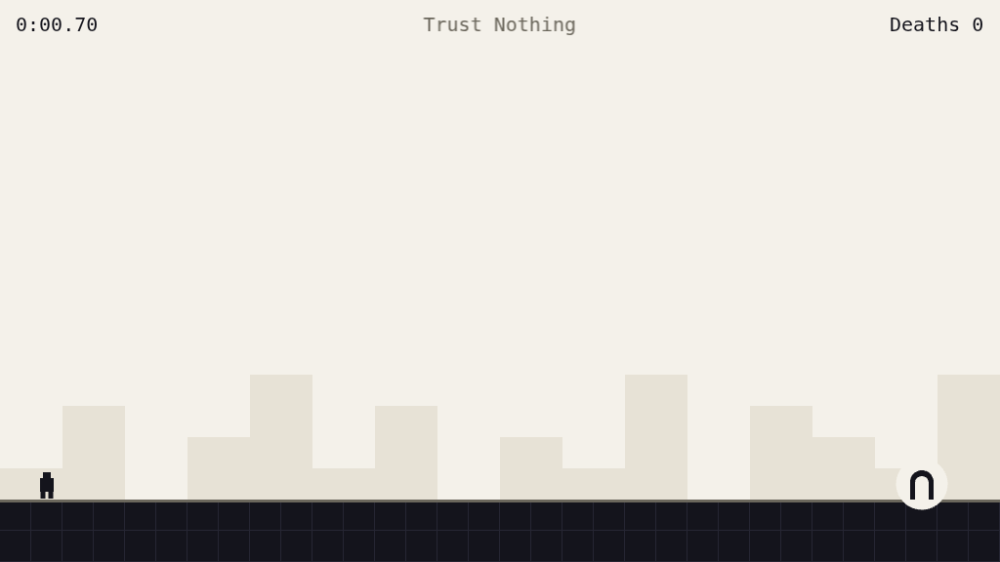
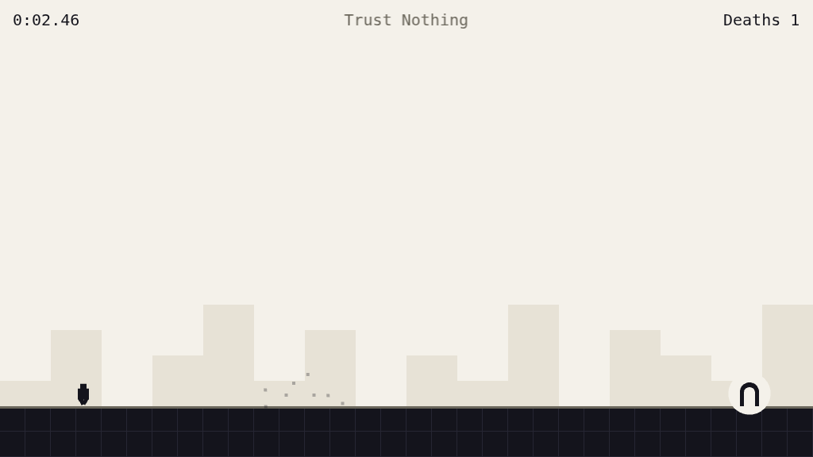
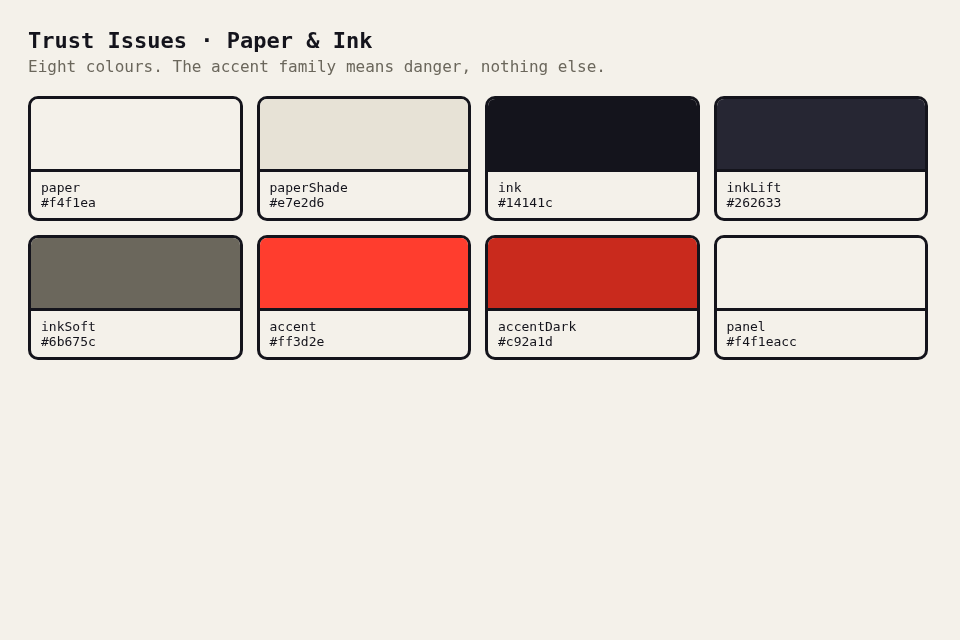
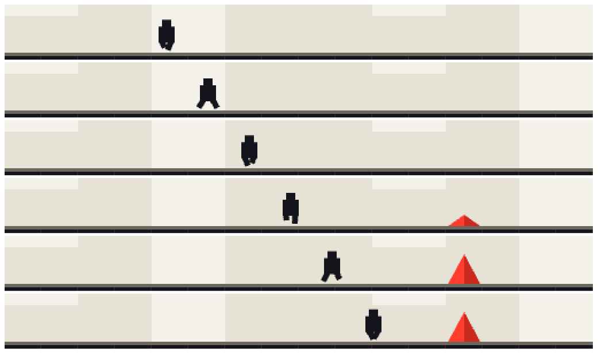
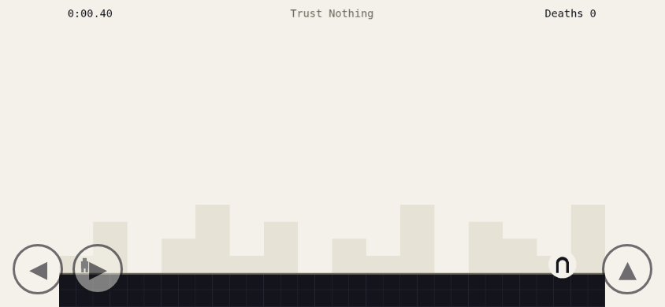

# Design

The look is "Paper & Ink", inspired by the stripped-down clarity of _Level Devil_: a flat
paper background, solid ink shapes, and a single accent colour that means danger. There is
nothing to look at that is not either the way forward or a way to die. A little depth and a
few small reactions keep it from feeling empty.

## Principles

- **Minimal on purpose.** Eight colours in total, no gradients, no outlines, no
  decoration. A colour or a shape has to earn its place by carrying gameplay information or
  by giving depth to the flat paper.
- **Readability first.** Ground, hazard, player and exit must be told apart at a glance, on
  a phone in sunlight.
- **The accent means danger.** Red-orange appears on things that kill and nowhere else.
- **Shape carries meaning too.** Hazards are triangles, goals are arches, so the game stays
  readable without colour perception.

## Palette

The single source of truth is `frontend/src/theme.ts`. It feeds Phaser (as numbers) and CSS
(as `--ti-*` custom properties). A test keeps it at eight colours at most and checks contrast.

| Role         | Name         | Colour      | Used for                               |
| ------------ | ------------ | ----------- | -------------------------------------- |
| Background   | `paper`      | `#f4f1ea`   | Canvas, page, door interior, exit halo |
| Depth        | `paperShade` | `#e7e2d6`   | Distant skyline behind the level       |
| Ink          | `ink`        | `#14141c`   | Solid tiles, player, door, main text   |
| Ink seam     | `inkLift`    | `#262633`   | Seams between tiles                    |
| Soft ink     | `inkSoft`    | `#6b675c`   | Surface edge of the ground, level name |
| Accent       | `accent`     | `#ff3d2e`   | Spikes and the finish title            |
| Accent shade | `accentDark` | `#c92a1d`   | Shaded facet of a spike                |
| Touch panel  | `panel`      | `#f4f1eacc` | Background of the on-screen buttons    |

Contrast (enforced in `theme.test.ts`): ink on paper at least 12:1, soft ink on paper at
least 4.5:1, accent against paper and against ink at least 3:1; the shading roles stay close
to the colour they shade.

## Elements

| Element       | Drawing                                                                 |
| ------------- | ----------------------------------------------------------------------- |
| Background    | Paper with a quiet skyline of distant blocks in the shade colour        |
| Solid tile    | Ink square with a faint seam; a soft edge on the surface that is walked |
| Spike         | Accent triangle with a darker facet                                     |
| Exit          | Ink arch with a paper opening inside a paper halo that breathes         |
| Player        | Faceless ink silhouette: head block, torso block, two short legs        |
| HUD           | Time left, level name middle, deaths right, monospace                   |
| Finish screen | Paper veil, accent title, ink time and deaths, soft hint                |

## The figure

After the original: a head block, a wider torso block and two short legs, no arms and no
face. The legs alternate while walking and lift while swinging forward, tuck when rising,
spread when falling, and the body bobs a little. The animation is a pure function in
`frontend/src/game/figure.ts` and only reads the simulation state.

## Reactions

Small, render-only effects (`frontend/src/game/effects.ts`) that never touch the simulation
or the replay:

- A spike pops out of the ground with a small overshoot when a trap reveals it.
- A tile that a trap removes shrinks away instead of vanishing.
- Dying throws a short burst of ink particles.

## Touch

Two circular buttons left (move) and one right (jump), 64 px, semi-transparent paper with an
ink ring. Pressed buttons invert to ink. Touch controls appear on touch devices and with
`?touch=1`.

## Changing the look

Change colours in `theme.ts` only. Drawing code uses `colorNumber('<role>')`, CSS uses
`var(--ti-<role>)`. Hard-coded colours in components are a review finding, and so is a
seventh colour.
